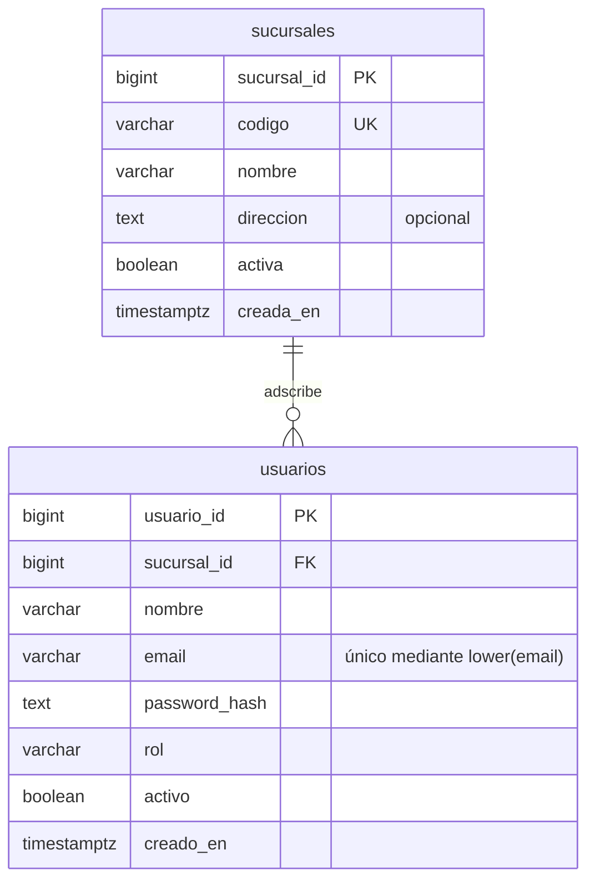

# DER del core implementado

Este diagrama muestra únicamente Fase 1. Las tablas aditivas `sesiones` y `auditoria`
del 26 se describen en `integracion-26-octubre.md`. El DER general y su exportación a imagen
se completarán al integrar el modelo de Rodrigo y Chris.

Fuente ejecutable: `sql/01_core.sql`. Relación obligatoria de usuario a sucursal,
sin borrado en cascada. Los detalles futuros están en `contratos.md`.
