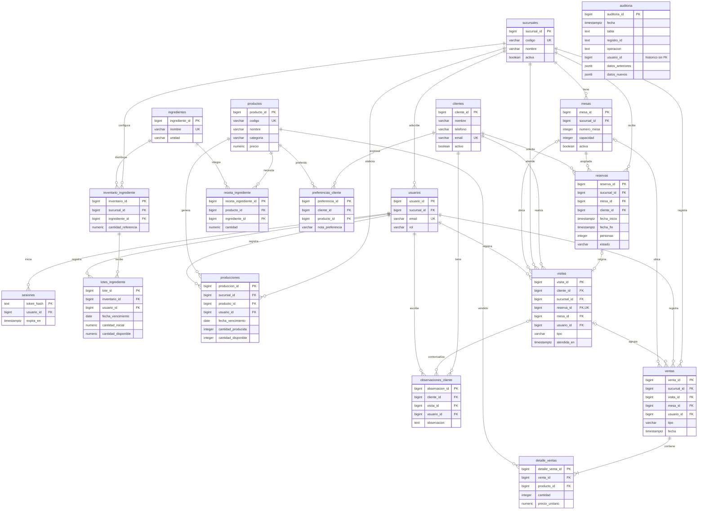

# DER completo de Habits — diseño aprobado

**Estado: aprobado por Andrew el 31 de octubre de 2026.** Se autorizó implementar
la base completa y después los precios iniciales propuestos de los doce productos.
La implementación y sus instrucciones están en [implementacion-bd-fase-1.md](implementacion-bd-fase-1.md).
El nombre del archivo se conserva para mantener los enlaces.

Fuentes y diagnóstico: [diseno-bd-completa.md](diseno-bd-completa.md).
Ejemplos de clase: [sql-explicado-fase-1.md](sql-explicado-fase-1.md).

## Resumen del modelo

Se proponen **18 tablas**: cuatro existentes, cinco adaptadas del trabajo de Chris
y nueve nuevas. No se añaden tablas de pagos, proveedores, entregas, pedidos abiertos,
lealtad, transferencias entre sucursales ni versiones de recetas.

- Se conserva el core, las sesiones y la auditoría sin rediseñar el login.
- Una visita representa una atención de un cliente identificado; varias ventas
  pueden pertenecer a esa misma visita.
- Una venta anónima puede existir sin visita. No suma frecuencia de clientes.
- Las existencias se guardan por lote. Las vistas suman cantidades disponibles;
  no hay un segundo total editable que deba sincronizarse.
- Una producción de un producto genera un lote terminado. Esa misma fila conserva
  cantidad producida, cantidad restante y vencimiento.
- La receta se representa mediante las filas producto–ingrediente. Con una receta
  actual por producto no hace falta una tabla adicional `recetas` uno a uno.

Estas reglas y su traducción a atributos, claves, relaciones e integridad fueron
aprobadas. La autorización cubre la base de datos de Fase 1, no backend ni otra fase.

## Convenciones del diseño

- PK nuevas: `BIGINT GENERATED ALWAYS AS IDENTITY`. FK del mismo tipo.
  Se conserva la PK textual de sesiones. Las tablas puente tienen ID propio y
  `UNIQUE` para su combinación de negocio: esto también permite reutilizar el
  trigger de auditoría existente, que recibe una columna PK.
- `NN` = NOT NULL; `?` = permite NULL. Una columna sin `?` es obligatoria.
- Fechas de eventos: `TIMESTAMPTZ`; vencimientos: `DATE`; interpretación de días
  y reportes en `America/Guatemala`.
- Importes: `NUMERIC(12,2)`, en quetzales. Cantidades de ingredientes:
  `NUMERIC(14,3)`. Unidades vendidas/producidas: enteros positivos.
- Texto de nombres/códigos no puede estar vacío tras quitar espacios.
- Dos sucursales y doce productos se verifican en la carga académica y sus pruebas.
  No se propone un trigger global para impedir para siempre una decimotercera fila.
- Las filas históricas se conservan; se desactivan catálogos. Se mantienen las
  excepciones existentes de sesiones y bitácora descritas más abajo.

## Diccionario completo de tablas

### 1. sucursales — existente

`sucursal_id BIGINT PK`; `codigo VARCHAR(30) UNIQUE`; `nombre VARCHAR(120)`;
`direccion TEXT ?`; `activa BOOLEAN DEFAULT true`; `creada_en TIMESTAMPTZ`.

Se conserva su estructura. No borrar una sucursal con operaciones vinculadas.
Desactivarla impide nuevas operaciones, pero no elimina su historia.

### 2. usuarios — existente

`usuario_id BIGINT PK`; `sucursal_id BIGINT FK → sucursales`;
`nombre VARCHAR(120)`; `email VARCHAR(254)`; `password_hash TEXT`;
`rol VARCHAR(20)`; `activo BOOLEAN DEFAULT true`; `creado_en TIMESTAMPTZ`.

Se conservan email único sin distinguir mayúsculas y los roles administrador,
gerente y mesero. Las operaciones nuevas registran al usuario responsable.
No se introduce FK compuesta usuario/sucursal: trasladar a un empleado no debe
cambiar ni invalidar sus ventas históricas. Su autorización actual se comprueba
al registrar la operación, no se deduce de una relación histórica.

### 3. sesiones — existente, infraestructura

`token_hash TEXT PK`; `usuario_id BIGINT FK → usuarios ON DELETE CASCADE`;
`creada_en TIMESTAMPTZ`; `expira_en TIMESTAMPTZ`.

Se conserva `expira_en > creada_en` y el comportamiento actual. Esta fase no añade
funcionalidades de autenticación. Se incluye para que el DER refleje toda la BD.

### 4. auditoria — existente

`auditoria_id BIGINT PK`; `fecha TIMESTAMPTZ`; `esquema TEXT`; `tabla TEXT`;
`registro_id TEXT`; `operacion TEXT`; `usuario_id BIGINT ?`; `actor_db TEXT`;
`datos_anteriores JSONB ?`; `datos_nuevos JSONB ?`.

`operacion` admite INSERT, UPDATE y DELETE. `usuario_id` es una referencia histórica
**sin FK**, como hoy, para conservar el evento si se elimina su actor. Los snapshots
siguen una lista de campos permitidos; no incluyen contraseñas ni tokens.
No se audita la propia bitácora ni sesiones. No es protección contra el dueño SQL.

### 5. mesas — adaptar Chris

`mesa_id BIGINT PK`; `sucursal_id BIGINT FK → sucursales`;
`numero_mesa INTEGER`; `capacidad INTEGER`; `activa BOOLEAN DEFAULT true`.

`UNIQUE(sucursal_id, numero_mesa)`; número y capacidad positivos.
`UNIQUE(mesa_id, sucursal_id)` permite FK compuestas que aseguran pertenencia.
Se propone omitir `ubicacion`: el diseño interior no es requisito de la consigna.
No se borra la mesa si tiene historia; no se cambia su sucursal si está referenciada.

### 6. clientes — adaptar Chris

`cliente_id BIGINT PK`; `nombre VARCHAR(120)`; `telefono VARCHAR(30) ?`;
`email VARCHAR(254) ?`; `activo BOOLEAN DEFAULT true`;
`fecha_registro TIMESTAMPTZ`.

Nombre y al menos un contacto. Email no vacío, con formato básico y
único mediante `lower(email)` cuando exista. Teléfono no vacío, sin unicidad:
familiares pueden compartirlo. Las compras anónimas no crean clientes ficticios.
El personal busca y reutiliza clientes; no se fusionan automáticamente por nombre
o teléfono. Desactivar conserva visitas, reservas y ventas asociadas.

### 7. productos — nueva

`producto_id BIGINT PK`; `codigo VARCHAR(30) UNIQUE`; `nombre VARCHAR(120)`;
`categoria VARCHAR(20)`; `precio NUMERIC(12,2)`;
`activo BOOLEAN DEFAULT true`.

Categorías: `bebida`, `panaderia`, `postre`; precio positivo.
El catálogo inicial contiene los doce productos acordados, seis/cuatro/dos.
El precio es común para ambas sucursales; no se añaden promociones o variantes.
Cambiarlo no altera los precios de detalles de ventas anteriores.
La categoría no debe cambiar una vez que tenga producción o ventas.

### 8. ingredientes — nueva

`ingrediente_id BIGINT PK`; `nombre VARCHAR(120)`; `unidad VARCHAR(10)`;
`activo BOOLEAN DEFAULT true`.

Nombre único sin distinguir mayúsculas. Una unidad base por ingrediente:
`g`, `ml` o `unidad`. Las recetas y lotes usan esa misma unidad.
No se implementan conversiones; no se cambia la unidad de un ingrediente utilizado.

### 9. receta_ingrediente — nueva, relación N:M

`receta_ingrediente_id BIGINT PK`; `producto_id BIGINT FK → productos`;
`ingrediente_id BIGINT FK → ingredientes`; `cantidad NUMERIC(14,3)`.

`UNIQUE(producto_id, ingrediente_id)` y cantidad positiva **por unidad de producto**.
Para producir cinco unidades se multiplica cada cantidad por cinco.
Una receta puede cambiar para operaciones futuras; no recalcula stock ya consumido.
No hay versiones de recetas. Antes de producir o vender una bebida, los procedimientos
deben exigir receta no vacía y validar todos sus ingredientes. Si un ingrediente está
inactivo o sin saldo suficiente, se rechaza la operación; nunca se omite de la receta.
El catálogo puede cargarse antes de su receta dentro del orden de inicialización.

### 10. inventario_ingrediente — nueva, configuración por sucursal

`inventario_id BIGINT PK`; `sucursal_id BIGINT FK → sucursales`;
`ingrediente_id BIGINT FK → ingredientes`;
`cantidad_referencia NUMERIC(14,3)`.

`UNIQUE(sucursal_id, ingrediente_id)`; referencia estrictamente positiva.
No guarda un total de existencias. Una vista suma los lotes de esta combinación.
Puede existir inventario configurado con cero lotes y, por tanto, cero disponible.
Si ya tiene lotes, sucursal_id e ingrediente_id no se cambian: hacerlo reinterpretaría
el ingrediente o la sede de todas sus existencias sin romper ninguna FK. La cantidad
de referencia sí puede ajustarse, con auditoría.

### 11. lotes_ingrediente — nueva, existencia real

`lote_id BIGINT PK`; `inventario_id BIGINT FK → inventario_ingrediente`;
`usuario_id BIGINT FK → usuarios`; `recibido_en TIMESTAMPTZ`;
`fecha_vencimiento DATE`; `cantidad_inicial NUMERIC(14,3)`;
`cantidad_disponible NUMERIC(14,3)`.

Inicial positiva; `0 <= cantidad_disponible <= cantidad_inicial`.
La cantidad restante se descuenta en transacciones. Una reposición es un lote nuevo;
no se incrementa un lote por encima de su entrada inicial. Ingrediente y sucursal
se obtienen de inventario_id, evitando copiarlos con riesgo de contradicción.
Se permite el consumo durante el día de vencimiento, hasta el final del
día local. Desde el día siguiente el lote no es utilizable aunque conserve cantidad.
FEFO: fecha de vencimiento ascendente, luego lote_id para desempatar.
Los lotes vencidos permanecen visibles para su descarte/auditoría.

### 12. producciones — nueva, también lote terminado

`produccion_id BIGINT PK`; `sucursal_id BIGINT FK → sucursales`;
`producto_id BIGINT FK → productos`; `usuario_id BIGINT FK → usuarios`;
`producida_en TIMESTAMPTZ`; `fecha_vencimiento DATE`;
`cantidad_producida INTEGER`; `cantidad_disponible INTEGER`.

Una fila produce un solo producto de panadería/postre. Cantidad producida positiva;
`0 <= cantidad_disponible <= cantidad_producida`.
Vencimiento no anterior al día local de producción. Se controla también
vencimiento y FEFO de terminados, sin añadir otra tabla de stock.
Validar categoría mediante función/trigger o procedimiento, no un CHECK que consulte
otra tabla. Una vista agrupa los lotes utilizables por sucursal/producto.

### 13. preferencias_cliente — adaptar Chris

`preferencia_id BIGINT PK`; `cliente_id BIGINT FK → clientes`;
`producto_id BIGINT FK → productos`; `nota_preferencia VARCHAR(150) ?`.

`UNIQUE(cliente_id, producto_id)`. Producto obligatorio; las notas libres
sin producto pertenecen a observaciones. Una preferencia no equivale a una compra
inferida: se registra explícitamente. Los productos se desactivan, no se dejan FK
en NULL borrando el catálogo histórico.

### 14. reservas — adaptar Chris

`reserva_id BIGINT PK`; `sucursal_id BIGINT FK → sucursales`;
`mesa_id BIGINT`; `cliente_id BIGINT FK → clientes`;
`fecha_inicio TIMESTAMPTZ`; `fecha_fin TIMESTAMPTZ`; `personas INTEGER`;
`estado VARCHAR(20) DEFAULT 'pendiente'`; `creado_en TIMESTAMPTZ`.

- FK `(mesa_id, sucursal_id) → mesas(mesa_id, sucursal_id)`.
- `personas > 0`; `fecha_fin = fecha_inicio + INTERVAL '90 minutes'`.
- Capacidad suficiente; mesa/sucursal/cliente activos al crear la reserva.
- Estados conservados de Chris: pendiente, confirmada, completada, cancelada.
- Ciclo: pendiente → confirmada o cancelada; confirmada → completada
  o cancelada. Completada/cancelada son finales, sin reactivación.
- Una reserva completada corresponde a una visita registrada. La llegada efectiva
  crea la visita y completa la reserva en una sola transacción.
- En sentido inverso, una visita vinculada exige reserva completada al terminar
  la transacción. No puede quedar asociada a una pendiente o cancelada.
- Exclusión por mesa e intervalo `[inicio, fin)` para pendiente, confirmada y
  completada. Mantener completadas conserva el bloqueo de su intervalo de noventa
  minutos, incluso si se marca llegada antes del fin; canceladas dejan de bloquear.
- `UNIQUE(reserva_id, sucursal_id, cliente_id, mesa_id)` para enlazar visitas sin
  cambiar cliente, mesa o sede por accidente.

La duración se conserva en dos columnas para aprovechar el SQL existente de Chris;
el CHECK evita que se contradigan. La sucursal redundante se protege con FK compuesta.
El control de reserva no es un sistema adicional de ocupación de mesas en tiempo real
para visitas espontáneas; ese comportamiento no se presume implementado.

### 15. visitas — nueva

`visita_id BIGINT PK`; `cliente_id BIGINT FK → clientes`;
`sucursal_id BIGINT FK → sucursales`; `reserva_id BIGINT ? UNIQUE`;
`mesa_id BIGINT ?`; `tipo VARCHAR(10)`; `atendida_en TIMESTAMPTZ`;
`usuario_id BIGINT FK → usuarios`.

- `tipo IN ('local', 'llevar')`; llevar no admite mesa ni reserva.
- Cliente obligatorio: el ranking cuenta atenciones identificadas, no clientes ficticios.
- FK `(mesa_id, sucursal_id) → mesas(mesa_id, sucursal_id)`, mesa opcional para
  atención local en mostrador. No cuenta cada acompañante del titular por separado.
- FK `(reserva_id, sucursal_id, cliente_id, mesa_id)` a la clave UNIQUE de reservas.
  CHECK: si hay reserva, mesa_id no puede ser NULL. Esto evita que el NULL salte
  la comprobación de coherencia de una FK compuesta.
- Reserva opcional y UNIQUE: una reserva admite cero o una visita.
- La llegada real crea la visita; no crear visitas por confirmar una reserva.
  `atendida_en` corresponde al momento real de atención, nunca a una cita futura.
  La operación de registro asignará ese momento, sin permitir programar visitas.
- `UNIQUE(visita_id, sucursal_id)` para ventas de la misma sede.
- `UNIQUE(visita_id, cliente_id)` para observaciones del mismo cliente.
- Una visita puede tener cero ventas; asistir no obliga a comprar.
- No usar UNIQUE(cliente_id, fecha): una persona puede volver el mismo día.
  Al añadir otra venta de la misma atención se reutiliza visita_id.

### 16. observaciones_cliente — adaptar Chris

`observacion_id BIGINT PK`; `cliente_id BIGINT FK → clientes`;
`visita_id BIGINT ?`; `usuario_id BIGINT FK → usuarios`;
`observacion TEXT`; `fecha_creacion TIMESTAMPTZ`.

Observación no vacía. Puede ser general del cliente o sobre una visita concreta.
FK `(visita_id, cliente_id) → visitas(visita_id, cliente_id)` impide atribuir la
observación a una visita de otra persona. No contiene datos de pagos ni credenciales.

### 17. ventas — nueva

`venta_id BIGINT PK`; `sucursal_id BIGINT FK → sucursales`;
`usuario_id BIGINT FK → usuarios`; `visita_id BIGINT ?`;
`mesa_id BIGINT ?`; `tipo VARCHAR(10)`; `fecha TIMESTAMPTZ`.

- `tipo IN ('local', 'llevar')`; llevar no admite mesa.
- FK `(mesa_id, sucursal_id) → mesas(mesa_id, sucursal_id)`.
- FK `(visita_id, sucursal_id) → visitas(visita_id, sucursal_id)`.
- Si hay visita, tipo y mesa deben coincidir con ella, incluyendo mesa NULL.
  Esa comparación requiere función/trigger, no una FK simple por visita_id.
- Cliente se obtiene a través de visita: no se duplica cliente_id en ventas.
  Visita NULL significa venta anónima; puede tener mesa local sin crear un cliente.
- No existe estado borrador/cancelada: se registran solo ventas confirmadas.
- No se guarda total independiente: se calcula sumando cantidad × precio_unitario
  de sus detalles, evitando total desactualizado.
- Cada venta confirmada tiene al menos un detalle. Se valida al terminar la
  transacción mediante un constraint trigger diferido; una FK sola no lo garantiza.
- Venta y detalles son históricos: el procedimiento de venta será el punto de
  escritura, sin operaciones de corrección posterior. El rol SQL habits_operaciones usa procedimientos sin DML directo sobre estas tablas; las FK por sí solas
  no impiden que una conexión privilegiada modifique ventas.

### 18. detalle_ventas — nueva, relación N:M

`detalle_venta_id BIGINT PK`; `venta_id BIGINT FK → ventas`;
`producto_id BIGINT FK → productos`; `cantidad INTEGER`;
`precio_unitario NUMERIC(12,2)`.

`UNIQUE(venta_id, producto_id)`; cantidad y precio positivos. Productos repetidos
en una venta se agrupan en una línea. Se guarda el precio del momento de venta.
No se guarda subtotal independiente; se calcula. Las cantidades de ingredientes
consumidas no se vuelven a calcular cuando se edita una receta posteriormente.

## DER con cardinalidades

En Mermaid, `||` = exactamente uno; `o|` = cero o uno; `o{` = cero o muchos;
`|{` = uno o muchos. El diccionario anterior especifica las FK compuestas y todos
los atributos; el diagrama mantiene las claves y atributos centrales para ser legible.

Auditoría queda sin línea FK hacia cada tabla: es una bitácora genérica existente,
no una relación referencial entre su registro_id textual y todas las entidades.

## Restricciones que requieren algo más que FK y CHECK

El consumo conserva el modelo híbrido de la propuesta:

| Operación | Qué consume | Qué registra |
|---|---|---|
| Vender bebida | Lotes de todos sus ingredientes según receta y cantidad | Venta y detalle |
| Producir pan o postre | Lotes de todos sus ingredientes según receta y cantidad | Producción como lote terminado |
| Vender pan o postre | Unidades de producciones utilizables | Venta y detalle, sin volver a consumir ingredientes |

Cada operación completa es una transacción. FEFO se aplica a los lotes utilizables
de la sucursal y se bloquean filas en orden común; si falta cualquier ingrediente
o producto, se revierten todos los descuentos y registros de esa operación.

| Regla | Mecanismo propuesto |
|---|---|
| No traslapes, incluso con dos reservas simultáneas | EXCLUDE GiST por mesa/rango y extensión btree_gist |
| Personas no exceden capacidad | Trigger de validación que consulta y bloquea la mesa; al cambiar capacidad, validar reservas afectadas |
| Misma sucursal/cliente/mesa en visita con reserva | FK compuesta, UNIQUE de destino y CHECK de nulabilidad |
| Reserva completada y visita vinculada se corresponden en ambos sentidos | Validación diferida al cierre de la transacción; completar y registrar visita juntos |
| Venta identificada coincide con tipo/mesa de visita | Trigger; relaciones de atención se vuelven inmutables al quedar vinculadas |
| Cada venta tiene al menos un detalle al confirmar | Constraint trigger diferido, no contar detalles antes de insertarlos |
| Producción solo de panadería/postre | Validación del producto y protección de cambios de categoría posteriores |
| No alterar unidad de ingredientes ya utilizados | Validación de actualización; no intentar convertir existencias silenciosamente |
| Ningún consumo usa vencidos o saldo insuficiente | Función de consumo FEFO dentro de la transacción y bloqueo de filas |
| Registrar toda venta/producción o nada | Procedimiento y una transacción; sin COMMIT dentro de cada descuento |
| Auditoría de cambios confirmados | AFTER INSERT/UPDATE/DELETE, dentro de la transacción del cambio |

Evitar disparar consumo desde múltiples lugares: el procedimiento consume, el
trigger audita y valida; el futuro backend no descuenta el mismo stock otra vez.
Las firmas y los permisos de los procedimientos se detallan en la guía de implementación.

## Borrado y actualización de relaciones

- FK de negocio: `ON DELETE RESTRICT` y sin cascadas de actualización de IDs.
  Eliminar un catálogo o cliente no elimina sus operaciones.
- Sesiones conserva su CASCADE al usuario; auditoría conserva su actor sin FK.
- No borrar ventas, producciones, visitas o reservas confirmadas/completadas por
  flujo normal. Cancelar reserva actualiza estado; no elimina la fila.
- Se pueden corregir contactos y editar preferencias/observaciones con auditoría.
- Las claves de cliente/sucursal/mesa de una atención con historia se congelan.
  Cambiar el nombre de una sede o contacto de cliente no altera esas claves.
- La identidad ingrediente/sucursal de inventarios con lotes, y la identidad
  producto/sucursal de producciones registradas, no se reasignan. Sus cantidades
  disponibles sí cambian por las operaciones de inventario.
- Un lote recibido no se mueve a otro inventario modificando inventario_id;
  eso sería una transferencia entre sucursales o ingredientes, fuera del alcance.
- Una reducción de capacidad se rechaza si invalida una reserva no cancelada que
  aún no terminó. No se reescribe la capacidad histórica de reservas pasadas.

## Índices propuestos con un propósito concreto

No repetir índices ya creados por PK, UNIQUE o EXCLUDE. Los siguientes son candidatos
a verificar con EXPLAIN sobre los datos de prueba, no una promesa de rendimiento:

| Índice | Consulta |
|---|---|
| reservas(cliente_id, fecha_inicio) | Historial de reservas de un cliente |
| reservas(sucursal_id, fecha_inicio) | Agenda por sede y período |
| visitas(cliente_id, atendida_en) | Historial y frecuencia de clientes |
| visitas(sucursal_id, atendida_en) | Visitas por sede y período |
| ventas(sucursal_id, fecha) | Comparación de sedes |
| ventas(visita_id) | Compras de una atención |
| lotes_ingrediente(inventario_id, fecha_vencimiento, lote_id) WHERE cantidad_disponible > 0 | Seleccionar lotes FEFO |
| producciones(sucursal_id, producto_id, fecha_vencimiento, produccion_id) WHERE cantidad_disponible > 0 | Seleccionar terminados FEFO |
| detalle_ventas(producto_id) | Ranking y referencias desde productos |
| observaciones_cliente(cliente_id, fecha_creacion) | Historial de observaciones |

Las otras FK se revisarán según sus consultas y acciones de borrado. No se crean
índices sobre cada columna por obligación académica.

## Vistas y reportes

- `v_stock_ingredientes`: suma de lotes utilizables por inventario, incluso cero.
- `v_stock_terminados`: suma de producciones utilizables por sede/producto.
- `v_totales_ventas`: cantidad de unidades e importe a partir de detalle_ventas.
- Reporte 1: top 10 productos por SUM(cantidad) vendida en el período.
- Reporte 2: top 10 clientes por COUNT(visita_id) real en el período de atendida_en,
  antes de unir ventas. Una reserva confirmada, futura o no atendida no cuenta.
- Reporte 3: top 5 clientes por reservas confirmadas/completadas, excluyendo
  pendientes/canceladas; agregar preferencias después del conteo. Período por
  fecha_inicio. Mostrar los conteos por estado y su total: son reservas, no visitas.
- Reporte 4: bajo stock actual y lotes con saldo cuyo vencimiento corresponde al mes
  seleccionado. Para esos lotes distinguir vencido, próximo (hoy a siete días) y
  posterior. El bajo stock es actual independientemente del mes; se rotula así.
- Reporte 5: reservas confirmadas/completadas por fecha_inicio y ventas confirmadas
  por fecha, para cada sede/período. Mostrar reservas por estado y total, cantidad
  de ventas e importe vendido; agregar cada grupo antes de unirlo con sucursales.
- Desempate de rankings: métrica descendente y PK ascendente. Fechas desde inclusivo
  hasta exclusivo, con límites locales convertidos a instantes. Sedes vacías incluidas.

Los reportes 3 y 5 miden reservas del período, incluidas las confirmadas aún no
atendidas; el reporte 2 mide exclusivamente asistencia real. No se mezclan esas
métricas. Una visita con tres ventas suma una visita y tres ventas.

## Orden de creación y carga

Para una base vacía, el orden real se basa en dependencias, no en los números actuales
de los archivos. La extensión requiere permisos de instalación en la base de prueba.

| Tabla | Tablas referenciadas directamente por FK |
|---|---|
| sucursales | Ninguna |
| usuarios | sucursales |
| sesiones | usuarios |
| auditoria | Ninguna; actor histórico sin FK |
| mesas | sucursales |
| clientes | Ninguna |
| productos | Ninguna |
| ingredientes | Ninguna |
| receta_ingrediente | productos, ingredientes |
| inventario_ingrediente | sucursales, ingredientes |
| lotes_ingrediente | inventario_ingrediente, usuarios |
| producciones | sucursales, productos, usuarios |
| preferencias_cliente | clientes, productos |
| reservas | sucursales, mesas, clientes |
| visitas | clientes, sucursales, reservas, mesas, usuarios |
| observaciones_cliente | clientes, visitas, usuarios |
| ventas | sucursales, usuarios, visitas, mesas |
| detalle_ventas | ventas, productos |

No hay ciclos de FK. La regla «reserva completada corresponde a una visita» sí
consulta en ambos sentidos; por eso sus triggers se instalan después de ambas
tablas y validan el estado final de la transacción, no una fila intermedia.

1. Extensión `btree_gist` y core `sucursales`, `usuarios`.
2. `sesiones` y `auditoria`, preservando estructura y funciones existentes.
3. Catálogos: `mesas`, `clientes`, `productos`, `ingredientes`.
4. `receta_ingrediente`, `inventario_ingrediente`, `preferencias_cliente`.
5. `lotes_ingrediente`, `producciones`, `reservas`.
6. `visitas` y después `observaciones_cliente`.
7. `ventas` y después `detalle_ventas`.
8. Funciones/constraint triggers entre tablas ya creadas, auditoría e índices.
9. Vistas y consultas de reportes; procedimientos aprobados para demostración SQL.
10. Carga reproducible pequeña en el orden de FK y pruebas de COMMIT/ROLLBACK.

En la copia existente no se repite db-init ni se eliminan datos: inicializar.sql
aplica una ampliación aditiva. Las entidades del SQL de Chris se adaptaron desde
su rama conservando trazabilidad; no se hizo merge de sus rutas.

## Segunda ronda — aceptada por Andrew

8. Permitir ventas anónimas sin visita; clientes identificados con al menos un contacto.
   La visita cuenta al titular de la atención, no a cada acompañante.
9. Una reserva admite cero o una visita y también existen visitas sin reserva.
   Registrar la llegada crea la visita real y completa la reserva vinculada,
   conservando su bloqueo de noventa minutos. La frecuencia cuenta solo visitas
   reales; las reservas confirmadas/completadas se cuentan en sus propios reportes.
   Una visita admite varias ventas sin multiplicar su frecuencia.
10. Una única fuente de stock por lote, totales en vistas; producción también es lote
    terminado con vencimiento y FEFO. Consumible hasta el final del día de vencimiento.
11. Una receta actual por producto, sin tabla cabecera ni versiones, usando g/ml/unidad;
    cambios afectan futuras operaciones, no consumos pasados.
12. Desactivar catálogos y clientes; conservar operaciones. Preferencias siempre sobre
    productos; observaciones libres y opcionalmente vinculadas a una visita.
13. Mantener dos sucursales y doce productos en la carga académica, verificados por
    pruebas, sin agregar triggers que impongan un máximo global permanente de filas.

Las respuestas y el DER completo fueron aprobados. Se implementa exclusivamente
la base de Fase 1; no hay autorización para avanzar a otra fase.

## Comprobación de cobertura de la consigna

Revisión documental contra la consigna original, páginas 2–3, y la propuesta de
Habits. «Cubierto» significa que el modelo tiene datos, relaciones y mecanismos
previstos; no significa que los casos de uso ya estén implementados o probados.

| Requisito | Soporte en las 18 tablas | Resultado del diseño |
|---|---|---|
| Usuarios y roles | usuarios, sesiones, sucursales | Core conservado; permisos efectivos y login fuera de este trabajo |
| Reservas y disponibilidad | mesas, clientes, reservas, visitas | Capacidad, 90 minutos, EXCLUDE, estados y llegada real |
| Inventario de ingredientes | ingredientes, inventario_ingrediente, lotes_ingrediente, receta_ingrediente, productos, producciones | Stock por sede, FEFO, vencimiento y umbral del 15 % |
| Historial de clientes | clientes, visitas, reservas, preferencias_cliente, observaciones_cliente | Asistencia independiente de reservas/ventas, preferencias y notas |
| Control automático de cambios | auditoria y triggers de tablas de negocio | INSERT/UPDATE/DELETE en la transacción original, sin secretos |
| Top 10 productos vendidos | productos, ventas, detalle_ventas | Sumar unidades de ventas confirmadas |
| Top 10 clientes frecuentes | clientes, visitas | Contar visitas reales, sin multiplicarlas por sus ventas |
| Top 5 reservas y preferencias | clientes, reservas, preferencias_cliente, productos | Contar primero reservas, después incorporar preferencias |
| Reporte mensual de insumos | inventario_ingrediente, lotes_ingrediente, ingredientes | Stock actual y vencimientos del mes; no histórico reconstruido |
| Comparación de sucursales | sucursales, reservas, ventas, detalle_ventas | Agregaciones separadas, incluir sedes sin operaciones |
| Menú común e inventarios separados | productos, receta_ingrediente, inventario_ingrediente, producciones | Dos sucursales y doce productos iniciales; sin máximos globales |
| DER y carga reproducible | Este diccionario y orden de dependencias | Diseño documentado; scripts y carga reproducibles implementados |

Los límites aceptados del 15 % sobre referencia y del reporte mensual se conservan
como interpretación acordada con Andrew; no se atribuyen al profesor como aclaración.
La rúbrica también exige aplicación, reportes ejecutables y presentación: disponer
del DER no completa esas entregas ni la implementación de la base.

## Conceptos de Base de Datos 1 en este diseño

| Concepto | Aplicación real prevista |
|---|---|
| Índices | Agenda por sede/fecha, historial por cliente y búsqueda FEFO; comprobar con EXPLAIN |
| Vistas | Stock utilizable y total de ventas calculados desde sus filas fuente |
| CTE | Agregar visitas, reservas y ventas por separado antes de combinar resultados |
| Funciones | Alerta del 15 %, validación entre tablas y consumo reutilizable FEFO |
| Procedimientos | Registrar llegada, cancelar reserva, producir y registrar una venta completa |
| Triggers | Auditoría, capacidad, coherencia de relaciones y verificaciones diferidas |
| Transacciones | Llegada + visita + cambio de estado; consumo + operación + auditoría, todo o nada |

Los ejemplos SQL explicados están en [sql-explicado-fase-1.md](sql-explicado-fase-1.md).
La implementación SQL no añade backend. La validación en PostgreSQL real incluye
conflictos entre conexiones, además de casos de una sesión.

## Criterios de verificación de la implementación

- Crear toda la BD desde cero y ampliar el core existente sin pérdida de datos.
- Rechazar FK huérfanas, reservas cruzadas de sede, capacidad insuficiente y traslapes.
- Aceptar dos reservas consecutivas de 90 minutos; cancelar libera el intervalo.
- Una reserva origina como máximo una visita; dos ventas no duplican su frecuencia.
- Una reserva confirmada sin llegada suma en reservas, pero no en frecuencia;
  completar por llegada no permite otra reserva superpuesta en los 90 minutos.
- Una visita sin reserva y una compra identificada para llevar cuentan una vez;
  una venta anónima no crea visita ni cliente.
- Un lote vencido no se consume; cantidades nunca negativas; FEFO con desempate estable.
- Producir y vender sin doble descuento; fallos revierten operación y bitácora juntas.
- Precios históricos constantes tras cambiar catálogo; venta sin detalles rechazada.
- Dos sucursales, doce productos, cinco consultas explicables con datos de prueba.

La evidencia ejecutada está en [verificacion-bd-fase-1.md](verificacion-bd-fase-1.md).
