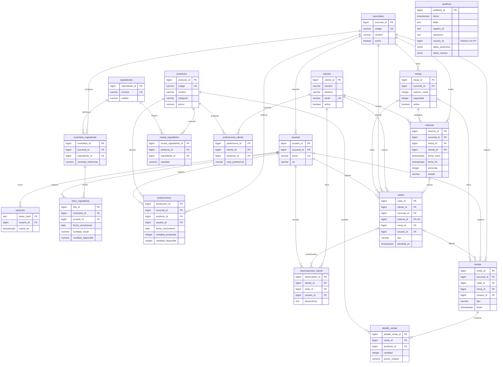

# Modelo entidad-relación de Habits

Para hacer la base de datos de Habits empezamos por pensar qué información necesita una cafetería en el día a día: clientes, mesas, reservas, ingredientes, productos y ventas. También teníamos que manejar dos sucursales sin mezclar sus inventarios. Con eso fuimos separando la información hasta llegar a **18 tablas**, relacionadas mediante llaves primarias y foráneas.

La idea fue que cada tabla guardara algo específico y que no tuviéramos que repetir los mismos datos en varios lugares. Por ejemplo, los productos son los mismos para ambas sucursales, pero las existencias de ingredientes se registran por separado.

## Clientes, mesas y reservas

Usamos `clientes` para guardar los datos de contacto, `mesas` para identificar las mesas de cada sucursal y `reservas` para relacionar a un cliente con una mesa y un horario. Un cliente puede tener varias reservas, pero cada reserva corresponde a una sola mesa.

Separamos `reservas` de `visitas` porque reservar no significa que el cliente haya llegado. Cuando se registra una llegada, queda una visita asociada. También podemos registrar visitas sin reserva, como cuando alguien entra directamente a comprar. Así, al hacer reportes, podemos contar las visitas reales sin confundirlas con las reservas.

Agregamos `preferencias_cliente` y `observaciones_cliente` para guardar lo que un cliente suele pedir o los comentarios que deja el personal. Eso permite consultar su historial sin meter toda esa información en la tabla de clientes.

## Productos, recetas e inventario

El menú se guarda en `productos` y los insumos en `ingredientes`. Como un producto usa varios ingredientes y un ingrediente puede estar en muchos productos, creamos la tabla intermedia `receta_ingrediente`. Allí guardamos cuánto necesita una unidad de cada producto.

Para el inventario usamos `inventario_ingrediente` y `lotes_ingrediente`. Cada sucursal tiene sus propias existencias y cada lote registra su cantidad y fecha de vencimiento. Preferimos hacerlo por lotes en vez de guardar un único total, porque necesitábamos saber qué ingredientes están vencidos y cuáles se deben usar primero.

El sistema calcula el stock disponible sumando los lotes que todavía se pueden utilizar. También marca una alerta cuando la cantidad disponible llega al **15 % o menos** de la referencia configurada para ese ingrediente y sucursal.

## Producción y ventas

En `producciones` registramos los panes y postres que ya se prepararon. Al producirlos se descuentan los ingredientes de su receta; cuando se venden, solo se descuentan las unidades terminadas. Con las bebidas es diferente: sus ingredientes se consumen directamente al registrar la venta.

Separamos `ventas` de `detalle_ventas` porque una compra puede incluir varios productos. En los detalles guardamos la cantidad y el precio cobrado en ese momento. Si después cambia el precio del menú, una venta anterior conserva su precio original.

Las ventas pueden asociarse a una visita para consultar el historial de compras de un cliente. También permitimos ventas sin cliente identificado, ya que no todos los compradores se registran.

## Usuarios y auditoría

Con `usuarios` y `sesiones` manejamos el acceso del personal. Tenemos tres roles: administrador, gerente y mesero. Cada uno tiene permisos diferentes según lo que necesita hacer, y las operaciones se revisan también por sucursal.

La tabla `auditoria` guarda los cambios realizados mediante los triggers de PostgreSQL. Así podemos revisar inserciones, actualizaciones y eliminaciones sin depender de que alguien lleve un registro manual. No guardamos contraseñas ni tokens dentro de esa bitácora.

## Cómo evitamos datos incorrectos

No dejamos todas las validaciones en los formularios. También definimos reglas en la base: llaves foráneas para mantener las relaciones, restricciones para los valores permitidos y controles para que una reserva no supere la capacidad de la mesa ni se cruce con otra reserva activa.

En producción y ventas usamos transacciones. Si falta inventario o falla una parte del proceso, se hace `ROLLBACK` y no quedan ventas ni descuentos a medias. Para consumir inventario usamos primero los lotes que vencen antes (FEFO), siempre que estén vigentes.

En resumen, organizamos el modelo de esta manera para poder administrar las dos sucursales, conservar el historial de cada operación y generar los cinco reportes del proyecto sin duplicar la información.

## Diagrama entidad-relación

Este es nuestro DER con las **18 tablas**, sus relaciones y sus campos principales. Las líneas muestran cómo se conectan las entidades. Las columnas completas, restricciones y procedimientos se encuentran en los scripts de `sql/`.

